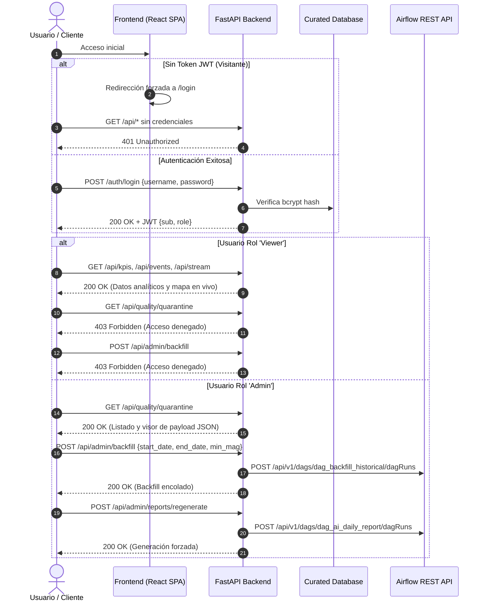

# Documento de Arquitectura de Ingeniería: Sistema SismoWatch

## 1. Propósito del Sistema y Decisiones que Habilita
**SismoWatch** es una plataforma integral de ingeniería de datos, control de calidad y analítica sísmica basada en inteligencia artificial, diseñada para convertir el feed público, volátil y heterogéneo del **Catálogo de Terremotos del USGS (United States Geological Survey)** en un producto de datos empresarial:
- **Resiliencia Operativa:** Ingesta continua a prueba de caídas o timeouts de la API fuente mediante reintentos exponenciales e idempotencia (`UPSERT`).
- **Garantía de Calidad (Quality Gate):** Bloqueo y cuarentena de anomalías métricas y geográficas previo a su exposición a capas de consumo analítico.
- **Detección No Supervisada de Anomalías:** Identificación de enjambres sísmicos, concentraciones espaciales atípicas y patrones multivariados de profundidad/magnitud mediante algoritmos de Machine Learning (`IsolationForest`).
- **Narrativas Ejecutivas Confiables (Cero Alucinaciones):** Generación de informes mediante Modelos de Lenguaje (LLM) fuertemente anclados en cálculos deterministas verificados con un mecanismo de post-validación fáctica.
- **Visualización en Tiempo Real:** Interfaz web interactiva (React + Leaflet + Tailwind) con transmisión de eventos por Server-Sent Events (SSE) y control de acceso basado en roles (RBAC).

---

## 2. Diagramas de Arquitectura y Flujo de Datos

### 2.1. Flujo de Datos de Extremo a Extremo (Pipeline Medallion & Quality Gate)

```mermaid
flowchart TD
    USGS["USGS Earthquake API\n(all_hour.geojson / historical query)"] -->|Poll / Web Request| DAG_INGEST["DAG: dag_ingestion_realtime\n(Airflow 2.8+)"]
    
    subgraph Data_Lakehouse ["PostgreSQL Lakehouse (Multi-Schema)"]
        DAG_INGEST -->|Insert Raw JSON Payload| RAW[("raw.earthquake_feeds\n(Audit Trail Inmutable)")]
        
        RAW -->|Extract & Normalize| DAG_TRANSFORM["DAG: dag_transformation_quality"]
        DAG_TRANSFORM -->|Flatten & Deduplicate| STAGING[("staging.earthquakes\n(Idempotent UPSERT)")]
        
        STAGING -->|Quality Gate Evaluation| PANDERA{"Pandera / Python\nQuality Gate"}
        
        PANDERA -->|Valid Records| CURATED[("curated.earthquakes\n(Indices: time, mag, coords)")]
        PANDERA -->|Rule Violations\n(Lat/Lon, Mag, Depth, Time)| QUARANTINE[("curated.quarantine\n(Root-cause attribution)")]
        PANDERA -->|Metrics & Score| AUDIT[("curated.quality_audit\n(Observability History)")]
    end

    subgraph AI_Analytics ["Motor Analítico & IA (Airflow Plugins)"]
        CURATED -->|Query Trailing 24h| KPI_CALC["Deterministic KPI Engine\n(Mathematical Aggregations)"]
        CURATED -->|Feature Extraction| ANOM_DET["IsolationForest &\nSpatial Swarm Clustering"]
        
        KPI_CALC --> AI_SYNTH["LLM Report Generator\n(Prompt Injection Filter)"]
        ANOM_DET --> AI_SYNTH
        
        AI_SYNTH --> FACT_CHECK{"Post-Generation\nFact-Checker"}
        FACT_CHECK -->|Passed| AI_REPORTS[("curated.ai_daily_reports")]
        FACT_CHECK -->|Discrepancy / Timeout| FALLBACK["Deterministic Template Fallback"]
        FALLBACK --> AI_REPORTS
        ANOM_DET --> ANOM_TABLE[("curated.ai_anomalies")]
    end

    subgraph Backend_Serving ["FastAPI Backend (Async)"]
        CURATED --> FASTAPI["FastAPI App\n(asyncpg + SQLAlchemy 2.0)"]
        QUARANTINE --> FASTAPI
        AUDIT --> FASTAPI
        AI_REPORTS --> FASTAPI
        ANOM_TABLE --> FASTAPI
    end

    subgraph Clients ["Capa de Consumo (Frontend Web)"]
        FASTAPI -->|JWT RBAC Auth| CLIENT_UI["React + Vite + Leaflet SPA"]
        FASTAPI -->|SSE Live Stream| SSE_LISTENER["Live Pulse & Real-time Alerts"]
    end
```

### 2.2. Modelo de Seguridad y Control de Acceso por Roles (RBAC)



---

## 3. Justificación Técnica de Decisiones Arquitectónicas

### 3.1. ¿Por qué Apache Airflow frente a Cron Jobs tradicionales?
1. **Observabilidad Centralizada y Trazabilidad:** Un script cron ejecuta en silencio o redirige stdout a logs desestructurados. Airflow ofrece un scheduler determinista con UI de monitoreo, historial de ejecuciones, SLAs, duración de tareas e inspección de logs por tarea.
2. **Políticas de Reintento con Backoff Exponencial:** Si USGS experimenta micro-cortes, un cron job falla sin reintento o requiere reintentos manuales desordenados. Airflow gestiona de forma nativa `retries=3`, `retry_delay=timedelta(seconds=30)`, y `retry_exponential_backoff=True` sin bloquear otros hilos.
3. **Manejo de Dependencias y Grafos Acíclicos Dirigidos (DAGs):** Airflow garantiza que la transformación y el Quality Gate solo se inicien cuando la ingesta del feed crudo haya completado satisfactoriamente (`TriggerDagRunOperator`).
4. **Idempotencia y Backfilling Parametrizado:** Cron no tiene noción de ventana temporal histórica parametrizable. Airflow permite disparar ejecuciones para cualquier ventana histórica (`dag_backfill_historical`) manteniendo exactamente la misma lógica de validación que el flujo en tiempo real.

### 3.2. ¿Por qué la Arquitectura de Tres Capas (Medallion: Raw, Staging, Curated)?
1. **Capa `raw` (Audit Trail Inmutable):**
   - Almacena el documento GeoJSON íntegro tal como fue provisto por USGS.
   - **Beneficio:** Si en el futuro USGS cambia la taxonomía de campos o si se descubre una nueva necesidad analítica, es posible reprocesar la historia completa desde `raw` sin perder información original.
2. **Capa `staging` (Limpieza Técnica & Deduplicación):**
   - Aplana estructuras anidadas (GeoJSON `geometry.coordinates` a `[lat, lon, depth_km]`), convierte marcas de tiempo epoch ms a UTC `timestamptz`.
   - Realiza `UPSERT` basado en `id` para consolidar actualizaciones provistas por sismólogos de USGS.
3. **Capa `curated` (Certificación de Calidad y Analítica):**
   - Solo entran los datos aprobados por el Quality Gate.
   - Posee índices optimizados (`time DESC`, `mag DESC`, `(latitude, longitude)`) para respuestas sub-segundo en APIs y dashboards.
   - Aísla completamente registros defectuosos en `quarantine`, garantizando que ninguna división por cero, valor fuera de escala o coordenada física imposible contamine los modelos de IA ni los indicadores de SuperApp.

### 3.3. Mitigación de Vulnerabilidades y Alucinaciones en IA
1. **Prevención de Prompt Injection:**
   - Textos provenientes del exterior (e.g., `properties.place`) se sanean con expresiones regulares para eliminar secuencias de escape de delimitadores (````, `###`), palabras clave de secuestro de instrucciones ("ignore all previous instructions", "system prompt") y caracteres de control antes de interpolarse en prompts.
2. **La Regla de Oro (Determinismo Primero):**
   - El LLM **nunca calcula estadísticas**. Las estadísticas (recuento exacto, magnitudes pico, promedios, alertas de tsunami) son calculadas primero mediante SQL/Pandas.
   - El LLM recibe las cifras precalculadas y se restringe a redactar la síntesis ejecutiva.
3. **Fact-Checking Automatizado:**
   - Un validador determinista analiza la respuesta del LLM y confirma que los números clave citados en la narrativa concuerden con los KPIs calculados.
   - Si la API del LLM experimenta indisponibilidad o falla la validación, el sistema conmuta automáticamente a un motor de plantillas determinista de alta fidelidad, asegurando disponibilidad del 100%.

---

## 4. Evolución y Escalado a Nivel de Producción Empresarial

Para entornos de hiperescala (cientos de miles de eventos concurrentes o feeds sísmicos IoT distribuidos), la arquitectura está concebida para transicionar sin fricciones:

| Componente Actual | Escalado en Producción a Gran Escala | Beneficio del Cambio |
| :--- | :--- | :--- |
| **Orquestación Airflow** | Despliegue en **Kubernetes con Celery/KubernetesExecutor** (Helm chart oficial en EKS/GKE). | Auto-escalado elástico de pods de tareas; aislamiento total de recursos por ejecución. |
| **Ingesta Streaming** | Adición de un clúster de **Apache Kafka / Confluent Cloud** con esquema Avro. | Ingesta masiva desacoplada, particionamiento por zona geográfica y soporte de backpressure. |
| **Almacenamiento Analítico** | Migración o réplica hacia **Snowflake / Google BigQuery / ClickHouse**. | Consultas analíticas ultrarrápidas sobre petabytes de series temporales sísmicas. |
| **Backend Serving** | FastAPI en contenedores orquestados con **Horizontal Pod Autoscaler (HPA)** detrás de Cloudflare / AWS ALB. | Capacidad para atender decenas de miles de peticiones HTTP/SSE simultáneas. |
| **Gestión de Secretos** | Inyección mediante **HashiCorp Vault / AWS Secrets Manager**. | Rotación automática de credenciales JWT, contraseñas de DB y API keys sin reinicios manuales. |
